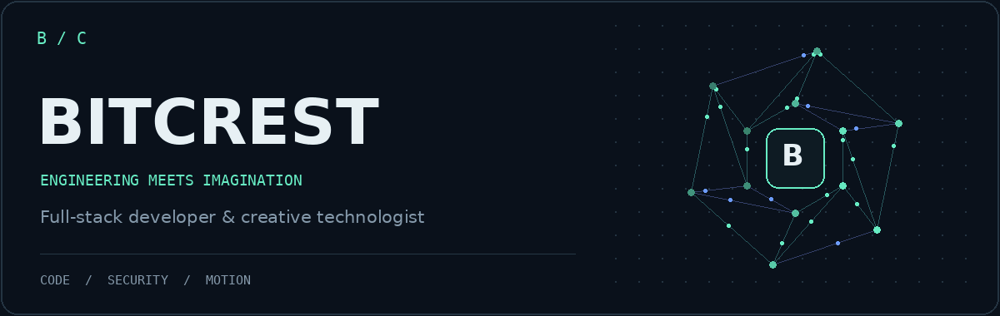
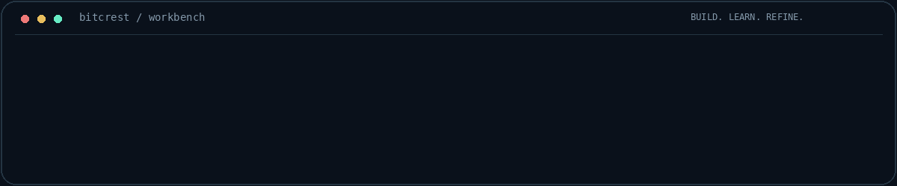

  

  <strong>Full-stack development · Cybersecurity · Creative technology</strong>
   
  Building tools that connect intelligent systems with thoughtful design.

  <a href="#what-im-building">Projects</a> &nbsp; / &nbsp;
  <a href="#my-toolbox">Toolbox</a> &nbsp; / &nbsp;
  <a href="#beyond-the-code">Creative work</a> &nbsp; / &nbsp;
  <a href="https://github.com/Bitcrest?tab=repositories">Repositories ↗</a>

---

### The person behind Bitcrest

I'm a full-stack developer and creative technologist from **Sri Lanka**. I work across web applications, network security tools, 3D animation, and motion design.

My projects explore a shared question: **how can complex technology become something useful, clear, and intuitive?**

  

### What I'm building

These projects are evolving through development, testing, and iteration.

| Project | The idea | Development focus |
| :--- | :--- | :--- |
| **MeshTrace AI** Network security · CLI | Make network activity easier to investigate through a security-focused command-line tool. | Packet capture, flow analysis, protocol enrichment, rule-based risk scoring, and alert correlation. Exploring AI-assisted investigation. |
| **ZellZap** Payment infrastructure | Explore payment gateway workflows for merchants and administrators. | Merchant onboarding, payment APIs, checkout flows, webhooks, and dashboard development. |
| **NexusFlow** Multi-tenant SaaS | Bring agency operations and client workspaces into one platform. | Agency and subaccount architecture, CRM pipelines, website/funnel building, and automation workflows. |

### My toolbox

| Area | Technologies I work with |
| :--- | :--- |
| **Interfaces** | Next.js · React · TypeScript · Tailwind CSS · shadcn/ui · Motion |
| **Backend & data** | Node.js · Python · Prisma · MySQL · REST APIs |
| **Network tooling** | Scapy · TShark · Packet analysis · Flow analysis · CLI development |
| **AI experimentation** | Ollama · Local LLMs · ComfyUI · AI-assisted workflows |
| **Design & animation** | Blender · After Effects · Photoshop · 3D modeling · Motion graphics |

### Beyond the code

I also create **3D characters and environments**, **motion graphics**, and **visual identities**. That creative practice shapes how I approach software: structure matters, but so do clarity, movement, and the way a product feels.

### Current direction

- Making MeshTrace's network evidence and incident views more useful for investigation.
- Developing the architecture behind payment systems and multi-tenant SaaS.
- Experimenting with local AI and creative automation.
- Bringing engineering and visual design into the same workflow.

---

  <strong>Build with curiosity. Refine with purpose.</strong> 
  BITCREST · Code / Security / Motion

